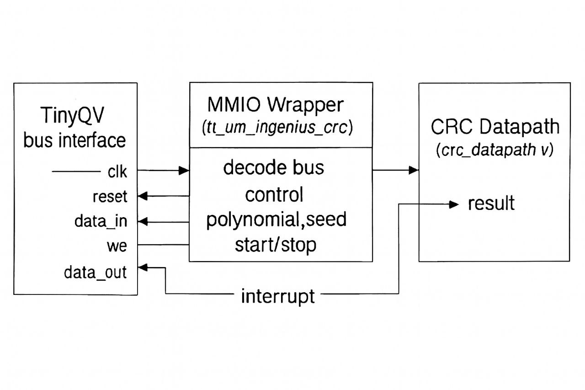

# DP1 Report – Team Ingenius

## 1. RTL Package
- **Peripheral Name:** Ingenius CRC Engine
- **Files:**
  - `rtl/user_peripherals/tqvp_ingenius/tt_um_ingenius_crc.v` (top-level wrapper)
  - `rtl/user_peripherals/tqvp_ingenius/crc_datapath.v` (datapath implementation)
- **Integration Slot:** 14
- **Interface:** Memory-mapped I/O (MMIO) with TinyQV bus signals

---

## 2. Design Rationale
- **Choice of Peripheral:** Cyclic Redundancy Check (CRC) engine for error detection in data streams.
- **Why CRC:** Lightweight, widely used in communication protocols, demonstrates datapath design and MMIO integration.
- **Architecture Highlights:**
  - Parallel datapath for efficient CRC computation
  - Configurable polynomial and seed values
  - Interrupt line for signaling completion

---

## 3. Verification
- **Testbench:** Cocotb-based test located at `test/user_peripherals/tqvp_ingenius/test.py`
- **Coverage:**
  - Known CRC vectors
  - Edge cases (zero input, max-length input)
  - Interrupt signaling
- **Results:** All tests passed ✔️ (attach logs/screenshots if available)

---

## 4. AI Prompt Logs
- **Design Prompts:** `prompts/design_prompts.md`
- **Debug Prompts:** `prompts/debug_prompts.md`
- **Summary:** Documented the iterative AI-assisted design process, including datapath refinement and MMIO integration.

---

## 5. Synthesis & PPA Results
- **Toolchain:** Yosys + OpenLane
- **Reports:** Located in `reports/`
- **Key Metrics:**
  - Area: `<insert value>`
  - Timing (Worst Negative Slack): `<insert value>`
  - Power Estimate: `<insert value>`
- **Notes:** CRC engine meets timing at target frequency.

---

## 6. Schematic / Block Diagram

*Description:* CRC datapath connected to MMIO wrapper, with bus interface and interrupt line.

---

## 7. Submission Tag
- **Commit Tag:** `DP1-Submission`
- **Repo:** Private team repo `AIHDL-Team_Ingenius-`